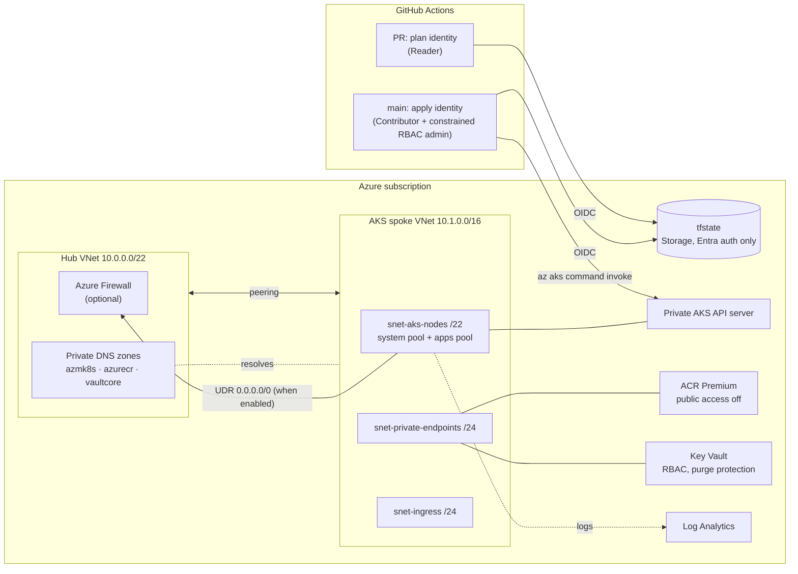

# Azure AKS Landing Zone (Terraform + GitHub Actions)

A hub-and-spoke Azure landing zone with a **private AKS cluster**, private-endpoint-only PaaS, centralised logging, and a **secretless GitHub Actions pipeline** (OIDC workload identity federation) with plan-on-PR, gated apply, drift detection and one-click teardown.

Built to production patterns, sized for a cost-controlled dev environment.

## What this demonstrates

| Area | Implementation |
|---|---|
| **Network isolation** | Hub-spoke VNets with peering. AKS API server, ACR and Key Vault are reachable only through private endpoints and private DNS zones owned by the hub. |
| **Private AKS** | Private cluster with a custom private DNS zone, Azure CNI Overlay with the Cilium dataplane and network policy, Azure Linux nodes, separate system and user pools, autoscaling to zero on the apps pool. |
| **Identity** | Entra ID-only cluster (local accounts disabled), Azure RBAC for Kubernetes, workload identity + OIDC issuer, user-assigned control-plane identity, least-privilege role assignments (AcrPull, Key Vault Secrets User). |
| **Egress control** | Optional Azure Firewall with the AKS FQDN tag and UDR forced tunnelling (`enable_firewall = true`); cluster `outbound_type` switches automatically. |
| **Observability** | Central Log Analytics with a daily cap, Container Insights via managed-identity data collection rule, AKS control-plane audit logs, Key Vault/ACR/Firewall diagnostics. |
| **Pipeline security** | No client secrets anywhere. Two federated identities: a read-only **plan** identity for PRs and an **apply** identity trusted only for the protected `dev` environment, whose role-assignment rights are constrained by an **ABAC condition** to the five roles the platform needs. |
| **Delivery** | Static analysis (fmt, validate, TFLint with the azurerm ruleset, Checkov), plan posted to the PR, the reviewed binary plan applied after approval, smoke test against the private API server, weekday drift detection that raises an issue, manual destroy. |
| **State** | Azure Storage backend with Entra ID auth only (shared keys disabled), blob versioning, soft delete and a delete lock. |

## Architecture



More detail, including the address plan and the trust model, is in [docs/architecture.md](docs/architecture.md).

## Repository layout

```
bootstrap/                 One-off: state storage + GitHub OIDC identities (local state)
environments/dev/          Root module for the dev landing zone
modules/
  network/                 Hub, spoke, peering, NSGs, private DNS, optional firewall + UDR
  aks/                     Private AKS, node pools, identities, RBAC, Container Insights
  acr/                     Private container registry + private endpoint
  keyvault/                Private RBAC Key Vault + private endpoint
  monitoring/              Log Analytics workspace
scripts/
  teardown-audit.sh        Read-only inventory before destroy, leftover check after
  destroy-bootstrap.sh     Final teardown of state account + GitHub identities
.github/
  actions/terraform-init/  Composite action: install Terraform + init backend
  workflows/
    terraform.yml          Static checks -> plan (PR comment) -> gated apply -> smoke test
    drift.yml              Weekday drift detection -> GitHub issue
    destroy.yml            Manual, approval-gated teardown
```

## Setup

### Prerequisites

- An Azure subscription where you are **Owner** (bootstrap creates role assignments).
- Azure CLI, Terraform ≥ 1.9, GitHub CLI (`gh`), TFLint and Checkov for local checks.
- `Microsoft.ContainerService` registered on the subscription (`az provider register -n Microsoft.ContainerService`).

### 1. Create the repo

```bash
gh repo create azure-aks-landing-zone --public --source . --remote origin --push
```

### 2. Bootstrap state and identities (once, locally)

```bash
az login
cd bootstrap
cp terraform.tfvars.example terraform.tfvars   # set subscription_id, github_owner, github_repo
terraform init
terraform apply
```

Keep `bootstrap/terraform.tfstate` safe (it is git-ignored). It holds the IDs of the state account and identities.

### 3. Configure GitHub

```bash
terraform output -raw github_cli_commands | bash     # sets the repo variables the workflows read
gh api -X PUT "repos/{owner}/{repo}/environments/dev"  # create the environment
```

Then in **Settings → Environments → dev**, add yourself as a **required reviewer** and restrict deployment branches to `main`. That reviewer gate is what stands between a merge and a live change.

No secrets are needed. The workflows read only these **variables**: `AZURE_TENANT_ID`, `AZURE_SUBSCRIPTION_ID`, `AZURE_CLIENT_ID_PLAN`, `AZURE_CLIENT_ID_APPLY`, `AZURE_APPLY_OBJECT_ID` and the three `TFSTATE_*` values.

### 4. Pin providers

```bash
make lock
git add environments/dev/.terraform.lock.hcl bootstrap/.terraform.lock.hcl
git commit -m "Pin provider versions" && git push
```

### 5. Deploy

Open a PR that changes anything under `environments/` or `modules/`. The pipeline runs the static checks and posts the plan as a PR comment. Merge, approve the `dev` deployment, and the saved plan is applied and the cluster smoke-tested.

## Working with a private cluster

The API server has no public endpoint. Options, in order of convenience:

```bash
# 1. Run kubectl inside the cluster through the ARM API (what CI uses)
az aks command invoke -g rg-lz-dev-uks-aks -n aks-lz-dev-uks --command "kubectl get pods -A"

# 2. From a VM or self-hosted runner inside a peered VNet
az aks get-credentials -g rg-lz-dev-uks-aks -n aks-lz-dev-uks
kubelogin convert-kubeconfig -l azurecli
kubectl get nodes
```

To give your own account cluster admin, add it in `terraform.tfvars`:

```hcl
extra_cluster_admins = {
  me = { object_id = "<az ad signed-in-user show --query id -o tsv>", type = "User" }
}
```

## Cost

Approximate UK South pay-as-you-go prices with the default settings. Check the [Azure pricing calculator](https://azure.microsoft.com/pricing/calculator/) for current figures.

| Component | Approx. cost |
|---|---|
| AKS control plane (Free tier) | £0 |
| 1 × Standard_D2s_v4 system node | ~£55/month |
| Apps pool (scales to 0 when idle) | £0 idle |
| ACR Premium | ~£40/month |
| Private endpoints (2) + Standard LB + public IP | ~£35/month |
| Log Analytics (2 GB/day cap) | usage-based, capped |
| **Default total if left running** | **~£130/month, ~£4/day** |
| Azure Firewall Standard (`enable_firewall = true`) | ~£25/day extra |

Run the **destroy** workflow when you are not using it. The state account (pennies) stays.

## Teardown

A full deployment creates six resource groups: `rg-lz-tfstate` from bootstrap, plus four for dev (`rg-lz-dev-uks-hub`, `-aks`, `-shared` and `-monitoring`), plus `rg-lz-dev-uks-aks-nodes`, which AKS creates and owns. Azure may also add a `NetworkWatcherRG` on its own the first time a VNet is created.

[`scripts/teardown-audit.sh`](scripts/teardown-audit.sh) makes sure the teardown leaves nothing behind that you didn't know about. It is read-only, and it runs on both sides of the destroy.

| Phase | What it checks | Fails when |
|---|---|---|
| `pre` | Every resource in the environment's groups, plus anything tagged `project`/`environment` elsewhere. Each one is labelled `managed`, `aks-managed`, `pe-nic`, `UNMANAGED` (made outside Terraform) or `OUTSIDE` (tagged for this environment but in another group). | Anything is `UNMANAGED` or `OUTSIDE`, so the run stops before anything is deleted |
| `post` | Remaining resource groups, tagged resources and Terraform state entries. It also lists leftovers that cost nothing: NetworkWatcherRG, and soft-deleted Key Vaults with their purge date. | Anything billable is still there |

### 1. Destroy an environment

From GitHub: **Actions → destroy → Run workflow**, then approve the `dev` deployment. Both audits are written to the run summary. If the `pre` audit finds `UNMANAGED` resources, the run stops before anything is deleted. Check the list, then either delete or import those resources, or remove them along with everything else using `make destroy ALLOW_UNMANAGED=true` locally.

Locally:

```bash
make audit                        # read-only inventory
make destroy                      # audit, terraform destroy, then verify
make destroy ALLOW_UNMANAGED=true # also remove what the audit flagged
```

### 2. Remove the bootstrap layer (only when you are completely finished)

```bash
scripts/destroy-bootstrap.sh      # or: make destroy-bootstrap
```

The script first runs the `post` audit for every environment, and refuses to continue if anything remains, because the environments' state lives in the account it is about to delete. After you type the resource group name to confirm, it removes:

1. the GitHub identities' subscription role assignments
2. both Entra app registrations
3. the state account's delete lock and the `rg-lz-tfstate` group

It finishes by printing the local and GitHub clean-up commands. Terraform's `destroy` isn't used here, because `prevent_destroy` and the lock deliberately protect the state account from it.

Things that are kept but cost nothing:

- The Key Vault stays soft-deleted for 7 days. Purge protection prevents an earlier purge, and the next deploy uses a fresh name.
- Deleted Entra apps sit in the recycle bin for 30 days.

## Validation

Every change runs through:

- `terraform fmt -check` and `terraform validate` on both root modules
- TFLint with the `recommended` preset and the azurerm ruleset
- Checkov across Terraform and the workflows. Accepted findings are skipped inline, each with a written reason. Search the code for `checkov:skip`.

Run the same locally with `make check`.

## Production hardening (deliberately out of scope for dev)

- `sku_tier = "Standard"` for the AKS uptime SLA; zone-redundant ACR; geo-replication.
- Host encryption and customer-managed keys for disks (needs the `EncryptionAtHost` feature and a Disk Encryption Set).
- Self-hosted runners in the spoke (or Managed DevOps Pools) so CI can push images to the private ACR and run `kubectl`/Helm directly.
- Azure Policy initiative assignments (for example the AKS pod security baseline) and Defender for Containers.
- Pin third-party actions to commit SHAs; add Dependabot for actions and providers.
- Additional environments (`environments/prod`) with their own state key, GitHub environment and federated credential.
- Budget alerts on the subscription.
